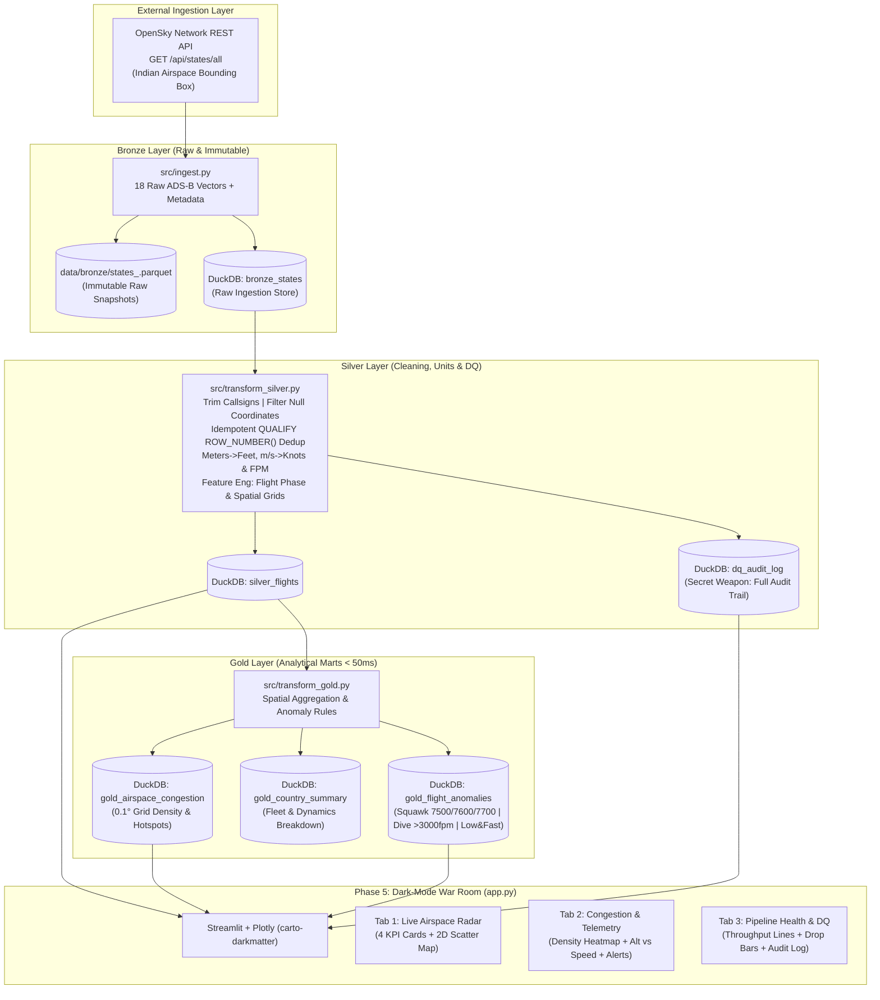

# 🛰️ Airspace Radar: Real-Time ADS-B Telemetry War Room

A production-grade, zero-server **Medallion Data Architecture (Bronze → Silver → Gold)** processing live ADS-B aircraft telemetry over Indian Airspace, backed by an embedded **DuckDB** analytical engine, immutable **Parquet** snapshots, and a high-performance **Streamlit + Plotly** dark-mode war room radar.

Designed with offline exam survival resilience: seamlessly toggles between **Live API Ingestion** and **Historical Replay** across banked snapshots so viva demos never fail if college Wi-Fi drops.

---

## 🏛️ System Architecture



---

## 📁 Project Folder Structure

```plaintext
airspace-radar/
├── data/
│   ├── bronze/              # Raw Parquet snapshots (immutable)
│   └── airspace.duckdb      # Local DuckDB analytical columnar database
├── src/
│   ├── ingest.py            # Phase 1 & 2: API fetch -> Bronze Parquet + DuckDB
│   ├── transform_silver.py  # Phase 3: Cleaning, unit conversion, DQ audit log
│   ├── transform_gold.py    # Phase 4: Congestion grids & operational anomalies
│   └── run_pipeline.py      # Pipeline runner (Single, Loop, Banking, Rebuild)
├── app.py                   # Phase 5: Streamlit + Plotly dark-mode war room radar
├── .env                     # Optional OpenSky credentials (OAuth2 / Basic)
├── requirements.txt         # Pinned production dependencies
└── README.md                # System documentation & Viva preparation
```

---

## ⚡ Quickstart

### 1. Setup Virtual Environment & Install Dependencies
```bash
python -m venv venv
source venv/bin/activate
pip install -r requirements.txt
```

### 2. Bank Offline Telemetry Snapshots
Bank 25 snapshots (enables full offline historical replay for vivas even if internet is down):
```bash
python src/run_pipeline.py --bank 25
```

### 3. Run a Single Medallion Pipeline Cycle
```bash
python src/run_pipeline.py --once
```

### 4. Launch the War Room Dashboard
```bash
streamlit run app.py
```
Open [http://localhost:8501](http://localhost:8501) in your browser.

---

## 🔬 Data Pipeline Phases & Engineering Specifications

### Phase 1 & 2: Bronze Layer — Raw Ingestion (`src/ingest.py`)
- **Bounding Box (Indian Airspace):** `lamin=6.0, lamax=37.0, lomin=68.0, lomax=97.5`.
- **Schema Mapping:** 18 positional ADS-B attributes mapped cleanly (`icao24`, `callsign`, `origin_country`, `time_position`, `last_contact`, `longitude`, `latitude`, `baro_altitude`, `on_ground`, `velocity`, `true_track`, `vertical_rate`, `sensors`, `geo_altitude`, `squawk`, `spi`, `position_source`, `category`).
- **Metadata:** Ingestion timestamp `ingested_at_utc` and API epoch `snapshot_time`.
- **Immutability:** Saves raw snapshot to `data/bronze/states_<snapshot_time>.parquet` and appends to `bronze_states` table in DuckDB. No destructive transformations in Bronze.

### Phase 3: Silver Layer — Cleaning, Units & Data Quality (`src/transform_silver.py`)
Inside DuckDB SQL, the messy raw transponder pings are transformed:
1. **String Normalization:** `COALESCE(NULLIF(TRIM(callsign), ''), 'UNKNOWN') AS callsign`
2. **Missing Coordinates:** Filtered via `WHERE latitude IS NOT NULL AND longitude IS NOT NULL`
3. **Idempotent Deduplication:**
   ```sql
   QUALIFY ROW_NUMBER() OVER (PARTITION BY icao24, snapshot_time ORDER BY last_contact DESC) = 1
   ```
4. **Aviation Standard Units:**
   - Altitude: `baro_altitude * 3.28084 AS altitude_ft` (meters to feet)
   - Ground Speed: `velocity * 1.94384 AS speed_knots` (m/s to knots)
   - Climb Rate: `vertical_rate * 196.85 AS vertical_rate_fpm` (m/s to ft/min)
5. **Feature Engineering:**
   - `flight_phase`: `CASE WHEN on_ground THEN 'ON_GROUND' WHEN vertical_rate > 2.5 THEN 'CLIMBING' WHEN vertical_rate < -2.5 THEN 'DESCENDING' ELSE 'CRUISING' END`
   - Spatial Grid Buckets: `ROUND(latitude, 1) AS grid_lat`, `ROUND(longitude, 1) AS grid_lon`
6. **Data Quality Audit Log (`dq_audit_log`):**
   Logs run-level metrics per snapshot: `run_timestamp`, `snapshot_time`, `raw_row_count`, `null_geo_dropped`, `duplicates_removed`, `silver_row_count`, `pass_rate_pct`.

### Phase 4: Gold Layer — Congestion & Anomaly Marts (`src/transform_gold.py`)
Pre-aggregated tables providing sub-5ms query performance:
1. `gold_airspace_congestion`: Groups by `(snapshot_time, grid_lat, grid_lon)`; flags clusters with `COUNT(*) >= 5` as `CONGESTION_HOTSPOT`.
2. `gold_country_summary`: Fleet counts, cruise speeds, and climb/descent ratios grouped by `origin_country`.
3. `gold_flight_anomalies`: High-priority operational alerting engine:
   - **Emergency Squawks:** `squawk IN ('7500', '7600', '7700')` (Hijack, Radio Failure, Emergency)
   - **Rapid Altitude Dive/Climb:** `ABS(vertical_rate_fpm) > 3000`
   - **Low & Fast Violation:** `NOT on_ground AND altitude_ft < 10000 AND speed_knots > 280`

### Phase 5: Dark-Mode War Room Dashboard (`app.py`)
- **Theme:** High-contrast tactical dark theme with military radar styling.
- **Modes:**
  - **Live Ingest:** Direct trigger button invoking the ETL pipeline.
  - **Historical Replay:** Interactive timeline slider across banked snapshots.
- **Tab 1 — Live Airspace Radar:**
  - 4 KPI cards (Active Aircraft, Barometric Avg Altitude, Ground Avg Speed, Congestion Hotspot Count).
  - Plotly 2D Scatter Map (`carto-darkmatter`, no API key needed) color-coded by flight phase with custom tooltips.
- **Tab 2 — Congestion & Telemetry Analytics:**
  - Spatial density map visualizing busy hubs (Delhi, Mumbai, Bengaluru corridors).
  - Altitude vs. Speed scatter plot revealing commercial jet cruise bands (30k–40k ft at 400–500 kts) vs. low regional turboprops.
  - Live Anomaly Alert Table from `gold_flight_anomalies`.
- **Tab 3 — Pipeline Health & Data Quality (The A+ Differentiator):**
  - Ingestion throughput trends (`raw_row_count` vs. `silver_row_count`).
  - Bar charts of GPS null drops, duplicate drops, and overall pass rates.
  - Interactive searchable `dq_audit_log` table.

---

## 🎓 Viva Questions & Answers (Examiner Defense)

### 1. "Why DuckDB instead of MySQL, PostgreSQL, or Apache Spark?"
> **Answer:** "DuckDB is an in-process, columnar OLAP engine purpose-built for vectorised analytical queries over Parquet files. Unlike PostgreSQL/MySQL which are row-oriented OLTP engines that incur heavy row-by-row scanning overhead, DuckDB executes aggregations, spatial grouping, and window functions in under 5 milliseconds with zero client-server latency and zero server administration. Unlike Apache Spark, DuckDB requires no JVM startup overhead or distributed cluster configuration, making it ideal for edge and embedded operational analytics. When scaling to 100x global volume, the exact same Bronze/Silver/Gold SQL logic migrates 1-to-1 onto Databricks Spark."

### 2. "How did you ensure pipeline idempotency if a snapshot is ingested twice?"
> **Answer:** "In the Silver layer, we employ analytical window deduplication:
> ```sql
> QUALIFY ROW_NUMBER() OVER (
>     PARTITION BY icao24, snapshot_time
>     ORDER BY last_contact DESC
> ) = 1
> ```
> If the same snapshot or transponder ping arrives multiple times, the window function partitions by aircraft transponder (`icao24`) and snapshot epoch, picking solely the latest contact signal and discarding duplicates. Furthermore, in DuckDB tables we delete and re-insert the snapshot atomically."

### 3. "What happens if OpenSky changes schema, returns NULLs, or drops offline?"
> **Answer:**
> - **Schema & Immutability:** Bronze preserves immutable raw Parquet files exactly as received.
> - **Data Quality Isolation:** Silver filters out incomplete GPS telemetry (`latitude IS NOT NULL AND longitude IS NOT NULL`) and converts empty strings to `'UNKNOWN'`.
> - **Audit Trail:** Every dropped record is measured and logged into the `dq_audit_log` table, guaranteeing transparency.
> - **Network Resilience:** The dashboard includes a Historical Replay slider powered by local banked snapshots in DuckDB, allowing complete offline demonstration without internet dependencies.

### 4. "What domain engineering did you apply for aviation data?"
> **Answer:**
> - Metric units returned by OpenSky are converted to ICAO aviation standards: meters to feet (`* 3.28084`), m/s to knots (`* 1.94384`), and vertical rate to feet per minute (`* 196.85`).
> - Calculated feature `flight_phase` based on ground status and vertical rate thresholds (`> 2.5 m/s` climbing, `< -2.5 m/s` descending, cruising otherwise).
> - Created spatial congestion bins (`ROUND(lat, 1)`, `ROUND(lon, 1)`) representing ~11 km square grids.
> - Operational anomaly triggers for transponder emergency squawks (7500, 7600, 7700), dive rates exceeding 3,000 fpm, and low-altitude high-speed violations below 10,000 ft.
